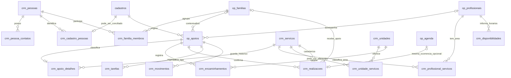

# Modelagem de dados do CRM — Instituto Mais Amor

Este documento acompanha a evolução do CRM e serve como material de estudo de Análise e Desenvolvimento de Sistemas. O objetivo é organizar o trabalho do Instituto: identificar pessoas e famílias, entender pedidos, encaminhar para uma equipe ou local adequado e conferir o apoio realmente realizado.

Os apoios informados pelo Instituto neste momento são cesta básica, acolhimento com roupas e utensílios para casa. O bazar beneficente é uma ação institucional. Não há parcerias confirmadas: o fluxo começa no próprio Instituto, e a possibilidade de cadastrar parceiros fica disponível para uma necessidade futura real.

A normalização é aplicada ao novo núcleo relacional. As tabelas e os registros anteriores são preservados para uma transição conferida pela administração. Não se afirma que todo o banco histórico passou a satisfazer todas as formas normais.

## O que cada registro significa

| Conceito | Significado no projeto | O que não deve ser confundido |
| --- | --- | --- |
| Pessoa | Uma identidade administrativa revisada pela equipe em `crm_pessoas`. | Cada formulário recebido não representa necessariamente uma pessoa diferente. |
| Cadastro recebido | Um contato ou solicitação original em `cadastros`, com protocolo e conteúdo de origem. | Não é confirmação de atendimento nem diagnóstico. |
| Família | Um grupo organizado em `op_familias`, ligado às pessoas por `crm_familia_membros`. | Número de integrantes não equivale a número de pessoas atendidas. |
| Pedido de apoio | Um caso em `op_apoios`, classificado por `crm_apoio_detalhes`. | Um pedido pode aguardar avaliação, disponibilidade ou encaminhamento. |
| Serviço | Um tipo de apoio configurado em `crm_servicos`, como cesta básica, acolhimento com roupas ou utensílios para casa. | Cadastrar um serviço não anuncia uma vaga ou oferta confirmada. |
| Unidade de destino | O local que organiza o apoio, começando pela unidade interna do Instituto em `crm_unidades`. | O cadastro do local não comprova convênio nem envia mensagens para ele. |
| Encaminhamento | O registro de que um pedido foi direcionado, com situação e retorno esperado. | Encaminhar não comprova que a família recebeu o apoio. |
| Realização | Uma entrega ou atividade efetivamente confirmada, com data e quantidade. | Marcar apenas o pedido como encaminhado ou concluído não gera uma nova realização. |
| Profissional | Uma pessoa da equipe em `op_profissionais`, com áreas de apoio e horários declarados. | Este cadastro não cria uma conta de acesso administrativo. |
| Tarefa | Um próximo passo com prazo, situação e responsável, quando definido. | Uma tarefa concluída pode ser apenas um telefonema, sem atendimento realizado. |

Não há campos de diagnóstico, laudo ou prontuário neste CRM. Registre somente informações necessárias à organização do apoio. Dados pessoais, observações e históricos permanecem na área administrativa protegida.

## Relacionamentos: uma pessoa pode ter vários pedidos

`||` significa exatamente um; `o|`, zero ou um; `o{`, zero ou vários. O desenho mostra as entidades usadas neste fluxo, sem reproduzir todas as tabelas de conteúdo, documentos e publicação do site.

O caminho entre pessoa e pedido passa pelo cadastro de origem: `crm_pessoas → crm_cadastro_pessoas → cadastros → op_apoios`. Assim, dois formulários da mesma pessoa podem ser conciliados com uma única identidade, sem apagar mensagens ou pedidos anteriores. Um cadastro também pode originar pedidos diferentes, como um pedido de cesta e uma necessidade de roupas.

## Chaves, integridade e decisões de projeto

- **Chave primária (PK):** identifica uma linha. Os cadastros principais usam identificadores; o nome da pessoa não é chave e pode se repetir.
- **Chave estrangeira (FK):** conecta uma linha a outra existente. Um encaminhamento precisa referenciar um pedido e uma unidade válidos.
- **Chave composta:** identifica um vínculo pelo conjunto de identificadores. O mesmo profissional não precisa aparecer duas vezes ligado ao mesmo serviço.
- **Unicidade:** um cadastro de origem só pode estar ligado a uma identidade canônica por vez. Uma ocorrência da agenda só pode estar ligada uma vez às realizações do CRM.
- **Domínios:** tipo de serviço, situações, prioridades e limites numéricos possuem valores controlados. Datas, referências e regras de fluxo também são verificadas no servidor.
- **Histórico e correção:** uma correção atualiza o mesmo identificador; o histórico registra a mudança. A revisão de um vínculo de identidade exige confirmação explícita quando já existe uma identificação diferente.

Não é seguro identificar pessoas automaticamente pelo nome ou telefone. Duas pessoas podem ter o mesmo nome; uma família pode compartilhar um telefone; um contato pode ser do cuidador. A equipe deve conferir o vínculo antes de unir formulários sob a mesma pessoa.

## Dicionário das entidades do fluxo

| Tabela | Responsabilidade | Chaves e relações relevantes |
| --- | --- | --- |
| `crm_pessoas` | Identidade canônica, nome e situação ativa. | PK `id`; o nome não é único. |
| `crm_pessoa_contatos` | Contatos separados por tipo e valor. | FK da pessoa; sem lista de telefones dentro de uma célula. |
| `crm_cadastro_pessoas` | Conciliação explícita de formulários com pessoas. | Um `cadastro_id` identifica no máximo uma pessoa; uma pessoa pode ter vários cadastros. |
| `crm_familia_membros` | Participação de pessoas em famílias e papel informado. | Vínculo entre `op_familias` e `crm_pessoas`. |
| `crm_servicos` | Catálogo de apoios e sua unidade de medida. | PK `id`; nome único; `tipo` cesta, atendimento ou outro; `unidade_medida` cesta, peca, item, atendimento ou atividade. |
| `crm_unidades` | Destino interno do Instituto e eventuais locais acrescentados depois. | PK `id`; a opção parceiro não significa que já exista uma parceria. |
| `crm_unidade_servicos` | Serviços informados por cada unidade. | Vínculo N:N, sem repetir a ficha completa da unidade. |
| `crm_profissional_servicos` | Áreas de atuação informadas por cada profissional. | Vínculo N:N com `op_profissionais`. |
| `crm_disponibilidades` | Faixas semanais declaradas, capacidade e situação. | FK do profissional; dia, início e fim são campos separados. |
| `op_apoios` | Pedido, origem, etapa, responsável e próximo passo. | Tabela anterior reaproveitada como cadastro principal do caso. |
| `crm_apoio_detalhes` | Classificação, prioridade, prazo e controle de versão do caso. | PK/FK do apoio; no máximo uma classificação por caso. O token `versao` protege contra duas gravações simultâneas. |
| `crm_encaminhamentos` | Destino, situação, retorno esperado e observações. | Vários encaminhamentos históricos por apoio; apenas um ativo por vez. |
| `crm_realizacoes` | Apoio confirmado, data, quantidade na unidade do serviço e referências na ocorrência. | FK do apoio e serviço; vínculo opcional e único com `op_agenda`. |
| `crm_tarefas` | Próximos passos com prazo e situação. | FK do apoio e responsável opcional. |
| `crm_movimentos` | Linha do tempo de alterações do caso. | Eventos acrescentados pelo servidor; não é uma ficha editável de atendimento. |
| `op_familias` | Referência administrativa da família. | Tabela anterior preservada; novos membros ficam na tabela de vínculo. |
| `op_profissionais` | Cadastro básico da equipe. | Tabela anterior preservada; novas áreas e faixas ficam em relações próprias. |
| `op_agenda` | Atividades da agenda anterior e sua situação. | Atividades realizadas entram na apuração; associação com realização evita duplicação. |
| `cadastros` | Formulários e registros de origem. | Preserva protocolo, contexto e conteúdo recebido. |

As colunas de texto livre anteriores, como disponibilidade genérica e contato de referência da família, continuam existindo por compatibilidade. O novo fluxo usa relações e faixas estruturadas onde foram acrescentadas; a preservação dessas colunas não equivale a uma normalização completa do legado.

## Normalização, com exemplos do Instituto

Normalizar é distribuir fatos entre relações para reduzir duplicação e evitar anomalias de inclusão, alteração e exclusão. Isso depende das regras do domínio e das dependências entre atributos, não apenas da quantidade de tabelas ou da presença de um `id`.

Os nomes e listas exibidos na tela são montados por consultas e relações. A API pode transportar uma lista em JSON sem que o banco guarde vários serviços numa única coluna; formato de transporte e estrutura de armazenamento são decisões diferentes.

### Primeira forma normal — 1FN

Cada atributo contém um valor do domínio definido, e não grupos repetidos de valores que precisam ser separados para consulta.

**Antes:** `profissional | serviços = "cesta, roupas, utensílios"` e `telefone1`, `telefone2`, `telefone3`.

**No novo modelo:** cada contato ocupa uma linha de `crm_pessoa_contatos`; cada vínculo profissional–serviço ocupa uma linha de `crm_profissional_servicos`. Uma faixa de disponibilidade tem um dia, um início e um fim. Um texto de observação pode continuar sendo texto: não é preciso transformar cada palavra em uma tabela.

### Segunda forma normal — 2FN

Além da 1FN, um atributo não-chave depende da chave candidata inteira, e não apenas de parte de uma chave composta.

**Problema:** numa tabela de vínculos com chave `(profissional_id, servico_id)`, guardar também `nome_profissional` cria dependência de apenas `profissional_id`.

**Solução:** o nome fica em `op_profissionais`; o nome e tipo do serviço ficam em `crm_servicos`; a relação guarda os identificadores do vínculo. Alterar o nome do profissional não exige corrigir cada serviço ao qual ele está ligado.

### Terceira forma normal — 3FN

Além da 2FN, removem-se dependências transitivas inadequadas entre atributos não-chave. Formalmente, para cada dependência funcional não trivial `X → A`, `X` deve ser superchave ou `A` deve pertencer a alguma chave candidata.

**Exemplo:** `servico_id → nome, tipo, unidade_medida`. Portanto, a classificação de um pedido guarda `servico_id`, sem copiar nome, tipo e unidade do catálogo para toda solicitação. O mesmo vale para o nome do profissional e os canais atuais da unidade.

Depois que um serviço aparece numa realização, seu tipo e sua unidade de medida não podem ser alterados. Para uma nova forma de apoio ou outra medida, crie um serviço distinto. Isso impede que uma alteração de catálogo transforme cestas antigas em atendimentos ou peças em itens. O nome e a situação ativa podem ser administrados conforme as regras do sistema.

Dados da ocorrência merecem tratamento diferente. A família, o serviço e o responsável registrados numa realização descrevem o que aconteceu naquela data. Não devem mudar silenciosamente porque o pedido ou a equipe foram reorganizados depois. São referências históricas do evento, e não cópias do cadastro atual usadas para exibição.

### Boyce–Codd — BCNF

BCNF exige que todo determinante de uma dependência funcional não trivial seja uma superchave. Ela é mais restrita que a 3FN.

No vínculo de origem, `cadastro_id → pessoa_id`: cada formulário é conciliado com no máximo uma identidade por vez, e `cadastro_id` é a chave dessa relação. Não se assume `nome → pessoa_id` nem `telefone → pessoa_id`, pois essas regras seriam falsas para o Instituto.

As relações simples de vínculo usam as dependências declaradas e as respectivas chaves. Isso favorece BCNF nesse núcleo; não constitui uma prova de BCNF para todas as tabelas antigas ou para regras de negócio ainda não definidas.

### Quarta forma normal — 4FN

Trata de dependências multivaloradas independentes. Não devemos produzir combinações artificiais entre conjuntos que pertencem à mesma entidade, mas não dependem entre si.

**Problema:** repetir cada área de um profissional para cada horário informado. Com três serviços e duas faixas, surgiriam seis linhas contendo os mesmos dados.

**Solução:** áreas ficam em `crm_profissional_servicos`; faixas ficam em `crm_disponibilidades`. Esta separação representa a regra atual: a disponibilidade é declarada para o profissional, sem vincular uma faixa específica a um serviço. Se no futuro cada faixa atender somente um serviço, essa nova regra precisa ser modelada explicitamente; não se deve presumir a independência.

### Quinta forma normal — 5FN

Trata de dependências de junção: decompor uma relação deve permitir reconstruir exatamente os fatos originais, sem perder dados nem inventar combinações.

Os vínculos profissional–serviço e unidade–serviço não provam que aquele profissional trabalha naquela unidade. Juntá-los pelo serviço gera apenas candidatos para avaliação, e não uma alocação confirmada. O encaminhamento registra explicitamente o destino e o profissional escolhido, quando houver.

Não criamos uma relação ternária profissional–unidade–serviço e depois a dividimos sem demonstrar uma dependência de junção válida. A 5FN deve ser avaliada a partir dessas regras reais; acrescentar tabelas arbitrariamente não garante que ela foi atingida. Não há afirmação de certificação global em 5FN para este banco.

### E 6FN ou forma normal domínio-chave?

A 6FN aparece principalmente em modelagem temporal mais especializada, com decomposições adicionais para fatos que variam de forma independente ao longo do tempo. Ela não é um requisito automático para um CRM institucional.

A forma normal domínio-chave, ou DKNF, procura expressar todas as restrições por domínios e chaves. Este sistema também possui regras de fluxo verificadas no servidor, como impedir conclusão sem realização confirmada. Portanto, não há promessa de DKNF. Use o nível de decomposição que torne as regras corretas, verificáveis e compreensíveis.

### Anomalias que esta separação evita

| Situação numa tabela misturada | Consequência | Separação usada |
| --- | --- | --- |
| Repetir o telefone atual em cada pedido. | Corrigir um pedido e esquecer os demais produz contatos divergentes. | Os contatos atuais ficam na pessoa; o formulário original preserva o que foi recebido. |
| Só permitir cadastrar uma unidade dentro de um pedido. | Não seria possível preparar a rede antes de chegar uma solicitação. | Unidades e seus serviços podem ser organizados independentemente dos pedidos. |
| Guardar o profissional apenas na última linha de atendimento. | Apagar essa ocorrência poderia eliminar sua única ficha. | Profissional é uma entidade própria; ocorrências apenas o referenciam. |
| Guardar total de pessoas apoiadas e incrementá-lo a cada edição. | Salvar novamente poderia inflar o resultado. | A apuração usa ocorrências e distinção de identidades, sem contador manual por clique. |

## Apoios reais, unidade de medida e bazar

| Registro | Classificação no CRM | Quantidade informada | Destino inicial |
| --- | --- | --- | --- |
| Cesta básica | Tipo cesta; unidade cesta. | Número de cestas realmente entregues. | Unidade interna do Instituto. |
| Roupas (acolhimento com roupas) | Tipo outro; unidade peça (`peca` no banco). | Número de peças realmente entregues. | Unidade interna do Instituto. |
| Utensílios para casa | Tipo outro; unidade item. | Número de itens realmente entregues. | Unidade interna do Instituto. |
| Bazar beneficente | Ação institucional em `acoes`. | Não é quantidade de apoio do CRM. | Organização interna do Instituto. |

Não some cestas, peças e itens como se fossem a mesma medida. Uma realização pode registrar cinco peças de roupa ou três utensílios e continua sendo uma ocorrência de apoio. Serviços classificados como atendimento representam uma ocorrência por registro e usam quantidade um; esse tipo está previsto na estrutura para uso quando houver uma oferta real, sem anunciar atendimento especializado que ainda não foi confirmado.

O bazar pode ser registrado na área de ações, com data, resumo e conteúdo conforme a atividade realizada. Não se transforma cada visitante ou venda em beneficiário. O sistema não presume que uma venda seja uma doação gratuita nem oferece, por esse registro, controle financeiro ou de estoque. Se uma pessoa receber efetivamente um apoio gratuito, a equipe registra esse fato separadamente no CRM, com seu tipo e quantidade corretos.

## Como os números são apurados

Os indicadores são calculados a partir dos fatos; não há um contador de pessoas incrementado a cada clique.

| Indicador | Regra do CRM |
| --- | --- |
| Pessoas apoiadas | Quantidade de identidades canônicas distintas ligadas a ocorrências realizadas no período. |
| Famílias apoiadas | Famílias distintas referenciadas nas ocorrências realizadas; não é soma dos integrantes. |
| Atividades realizadas | Ocorrências confirmadas, reunindo agenda realizada e realizações do CRM. |
| Cestas entregues | Soma das quantidades efetivamente realizadas para serviços do tipo cesta. |
| Cadastros sem identidade conciliada | Origens com ocorrência realizada que ainda não foram ligadas a uma pessoa canônica. Não são convertidas em pessoas únicas. |

A apuração usa o mês institucional de Brasília. Se uma realização estiver ligada à mesma ocorrência da agenda, essa ocorrência entra uma única vez. Corrigir a realização substitui os dados do mesmo identificador. Cancelá-la retira seu efeito da apuração, inclusive quando havia vínculo com a agenda.

Uma pessoa com três entregas no mês conta uma vez no indicador de pessoas e três ocorrências no indicador de atividades. Se cada entrega contiver duas cestas, são seis cestas. Sem família vinculada, não se inventa uma família. Sem identidade conciliada, o apoio pode aparecer como ocorrência, mas não é anunciado como uma nova pessoa única.

A mesma pessoa apoiada em dois meses conta uma vez em cada mês. Para obter pessoas distintas em um ano, é necessário consultar as ocorrências do ano e aplicar a distinção nesse intervalo; somar os totais mensais pode repetir a mesma pessoa.

Cadastros recebidos, pedidos abertos, tarefas, agendamentos e encaminhamentos não são apoios realizados. Os totais manuais e os registros operacionais históricos continuam separados até uma conciliação documentada. Importá-los indiscriminadamente poderia contar o mesmo fato duas vezes.

## Exemplo de trabalho: um pedido de cesta básica

O exemplo abaixo é fictício para estudo. Ele não deve ser inserido no banco de produção como se fosse uma atividade real.

1. Uma pessoa adulta envia um pedido de apoio. O formulário permanece em `cadastros` com seu protocolo.
2. Na triagem, a equipe verifica se é a mesma pessoa de um registro anterior. Vincula o cadastro a uma pessoa existente ou cria uma identidade revisada; não decide apenas pelo telefone.
3. A equipe vincula a família, quando conhecida, e classifica o pedido no serviço Cesta básica, medido em cestas. Define prioridade, responsável, prazo e próximo passo.
4. O CRM apresenta a unidade interna do Instituto e pessoas da equipe vinculadas a esse apoio, quando cadastradas. A equipe verifica a disponibilidade real e registra quem ficará responsável pela separação e entrega. Um destino parceiro só deve ser cadastrado se uma parceria vier a existir de fato.
5. Uma tarefa pode lembrar a equipe de confirmar a separação da cesta ou combinar a retirada. A ausência de resposta continua visível; não equivale a entrega.
6. Depois da entrega, a equipe registra a realização, a data e a quantidade de cestas efetivamente entregues. Se o evento já estiver na agenda, usa o vínculo com essa ocorrência, em vez de criar duas contagens do mesmo fato.
7. O painel e os indicadores públicos consultam os agregados do banco. A equipe pode concluir o pedido quando há realização confirmada; fechar a etapa não cria uma entrega adicional.
8. Se houver erro na data ou quantidade, corrige o mesmo registro. Se a entrega não aconteceu, cancela a realização com justificativa, em vez de manter números incorretos.

## Transição e operação responsável

A migração adicional acrescenta estrutura sem apagar cadastros, projetos, agenda ou totais anteriores. Não converte automaticamente nomes semelhantes em pessoas iguais e não inventa parceiros, famílias ou entregas. A preparação inicial depende de uma ação explícita da administração. Ela configura Cesta básica, Roupas e Utensílios para casa, com suas unidades de medida, e o destino Instituto Mais Amor — apoio interno; não acontece na migração SQL e não cria famílias, pedidos ou entregas fictícias. Categorias e destinos existentes devem ser revisados, sem presumir que sugestões antigas sejam ofertas atuais.

A equipe deve revisar pendências de identidade, classificar pedidos antigos, manter o destino interno e cadastrar outros somente quando confirmados e manter responsáveis e prazos atualizados. A capacidade semanal é uma declaração operacional; não calcula, sozinha, vaga livre ou reserva de horário. Notificações e mensagens externas dependem de integrações próprias; registrar um encaminhamento não envia WhatsApp ou e-mail.

O cadastro de profissionais organiza sua atuação, mas o acesso ao painel continua dependendo das permissões administrativas existentes. Não compartilhe a conta administradora como solução de acesso da equipe. Acesso individual por função é uma evolução separada.

No código, a interface fica em `dist/crm-admin.js`, as regras em `worker/crm.js`, e a estrutura adicional em `drizzle/0011_crm.sql`. Os testes do CRM usam dados em memória. Eles devem verificar autorização, vínculos, referências, contagem distinta, correção e cancelamento, sem inserir exemplos na produção.
